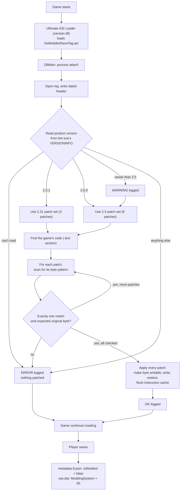
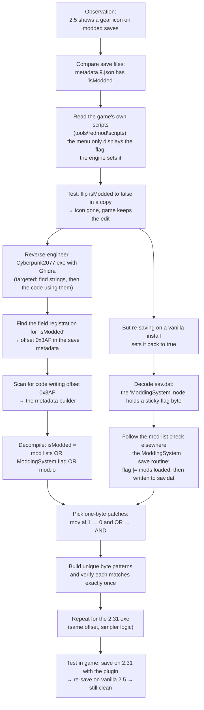

# NoModdedSaveTag

**Stop Cyberpunk 2077 from tagging your saves as "modded".**

An Ultimate ASI Loader plugin for Cyberpunk 2077 (PC) that keeps new saves from being flagged as modded, so they load as vanilla saves on other installs and platforms.

> [!WARNING]
> **Experimental.** This plugin changes a few bytes of the game's code in memory at startup. It has been tested on a small number of saves on one PC. Keep backups of your saves, and read [Status](#status) before using it.

---

## Why

Patch 2.5 (the Edgerunners 2 update) added official mod support. With it, the game marks every save made while mods are loaded:

- On PC, the save gets a **gear icon** in the Load Game menu.
- On console, a modded save **can't earn trophies or achievements**, according to the 2.5 patch notes.

PC players who use mods, then carry a save to console through Cross Progression, bring that tag with them. Flagging saves is not a very punk thing to do, so this plugin stops it.

## How a save gets tagged

The game records "modded" in **two** places in every save:

| Where | What | Why it matters |
|---|---|---|
| `metadata.9.json` → `"isModded"` | true / false | What the Load Game menu reads to show the icon. |
| `sav.dat` → `ModdingSystem` node | 1 byte, `01` / `00` | **Sticky.** When you load a save, the game takes this flag and ORs it into every later save, even on a completely unmodded install. |

The flag is set if **any** of these are true when the game saves:

1. The engine's mod lists aren't empty (mod archives were loaded).
2. The `ModdingSystem` flag carried over from the save you loaded is set.
3. Any mod.io mods are enabled (2.5 only).

Editing `metadata.9.json` alone doesn't last: the sticky byte in `sav.dat` sets it back to `true` on your next save.

## What the plugin does

At game startup it finds the few instructions that compute the flag and changes **one byte** in each:

| Original | Patched | Effect |
|---|---|---|
| `B0 01` `mov al, 1` | `B0 00` `mov al, 0` | "Mods are loaded" always comes out as no. |
| `08 xx` `or [flag], reg` | `20 xx` `and [flag], reg` | Other sources can no longer set the flag; it stays 0. |

Each replacement is the same size as the original, so no code moves and no jump targets change. Nothing is hooked or injected, and the game's files on disk are never touched; the changes exist only in memory while the game runs.

Result: every new save is written with `isModded = false` **and** `ModdingSystem = 00`, so it stays clean when re-saved anywhere.

## Status

| Game version | Detection | Patches | Tested in game |
|---|---|---|---|
| 2.31 | ✅ | 3 | ✅ Saves come out clean, and a re-save on vanilla 2.5 stays clean |
| 2.5 | ✅ | 6 | ✅ A tagged save re-saved with the plugin comes out clean, and shows clean on PS5 |
| PS5 (via Cross Progression) | — | — | ✅ Clean saves show no modded icons and still unlock trophies |
| Newer than 2.5 | ⚠️ Tries the 2.5 patches and logs a warning | — | ❌ |
| Anything else | ❌ Nothing is patched | — | — |

**Known limitations**

- **Existing saves stay tagged.** The plugin only affects saves written while it's running. Load an old save and save again to get a clean copy.
- **Game updates.** A new patch will most likely move the code. The plugin then finds no match, logs why and patches nothing. It won't break the game, but it needs updated patterns to work again.
- **Console: confirmed on PS5.** A tagged save shows the modded and broken-trophy icons; the same save re-saved with the plugin shows neither. A character played modded on PC (2.31), saved clean with the plugin and transferred via Cross Progression went on to unlock a Phantom Liberty trophy (*Arachnophobia*) on PS5. Xbox hasn't been tested.
- **mod.io:** the mod.io patches haven't been tested with mod.io mods actually enabled.

## Requirements

- Cyberpunk 2077 **2.31** or **2.5** (PC, GOG or Steam)
- **[Ultimate ASI Loader](https://github.com/ThirteenAG/Ultimate-ASI-Loader)** as `bin\x64\version.dll`. It ships with **Cyber Engine Tweaks**, so if CET is installed you already have it.
  - Without CET, download the **x64** build (`Ultimate-ASI-Loader_x64.zip`), and rename its `dinput8.dll` to `version.dll` in `bin\x64`. The 32-bit build silently does nothing in the 64-bit game. Tested with v10.0.0.

It doesn't need RED4ext, redscript or any other framework, and it has no dependency on CET itself.

## Installation

1. Make sure `bin\x64\version.dll` (Ultimate ASI Loader) exists in your game folder.
2. Copy `NoModdedSaveTag.asi` to `<game>\bin\x64\plugins\`. Create the `plugins` folder if needed.
3. Start the game and check `bin\x64\plugins\NoModdedSaveTag.log` (see below).

With Vortex, install the release zip like any other mod; it already has the `bin\x64\plugins` layout.

**To uninstall,** delete `NoModdedSaveTag.asi`. Saves you made while it was installed stay clean.

## The log

Each launch appends a block to `NoModdedSaveTag.log`, next to the plugin. The file keeps the last 20 launches (about 10 KB); older ones are trimmed off the top automatically:

```
################################################################################
NoModdedSaveTag 1.5 | 2026-10-24 14:28:46
################################################################################
game exe: D:\GOG Games\Cyberpunk 2077 [v2.31]\bin\x64\Cyberpunk2077.exe
exe file version 3.0.80.51928, product version 2.3.1
detected game version 2.31 -> using 2.31 logic
patched 'metadata: mod lists -> mov al,0' at exe+0xE61E56
patched 'ModdingSystem: mod lists -> 0' at exe+0x247651F
patched 'ModdingSystem: or -> and' at exe+0x2476520
OK (2.31 logic): new saves will be written with isModded = false and ModdingSystem flag = 0
```

The last line tells you the outcome. `OK` means the patches are active. An `ERROR` line explains why nothing was patched, and the game runs unmodified.

## How it runs



A patch set is **all or nothing**: every pattern is located and checked before any byte is written, so a set is never half-applied.

## How the patch was found

This is the path taken to work out what to patch, for anyone who wants to verify it or update it for a future game patch.



**Findings at a glance**

| | 2.31 | 2.5 |
|---|---|---|
| Metadata builder | `exe+0xE61CB0`: mod lists only | `exe+0x22FF7E0`: mod lists, ModdingSystem flag, mod.io |
| ModdingSystem save routine | `exe+0x24764D8`: flag \|= mod lists | `exe+0x2A1EA64`: flag \|= mod lists \| mod.io |
| `isModded` offset in save metadata | `0x3AF` | `0x3AF` |

The offsets are for the builds tested (2.31: file version 3.0.80.51928; 2.5: 3.0.88.46235). The plugin finds the code by byte pattern, not by these addresses.

## Building from source

Requirements: Visual Studio 2022 or later (Community, Professional, Enterprise or Build Tools) with the **Desktop development with C++** workload. The build scripts find it automatically through `vsenv.bat`.

```bat
build.bat
```

This produces `build\NoModdedSaveTag.asi`. It's a single source file with no dependencies beyond the Windows SDK. It's built with `/MT`, so players don't need the Visual C++ runtime installed.

**Test tools** (each built by the matching script in `test\`):

| Build script | Tool | What it does |
|---|---|---|
| `test\build_test.bat` | `test\harness.exe <path to Cyberpunk2077.exe>` | Runs version detection and pattern matching against an exe on disk without patching anything. Use it to check whether the patterns still match a new game build. |
| `test\build_hardening.bat` | `test\hardening.exe <path to Cyberpunk2077.exe>` | Loads the exe into its own process and tests patching, the already-patched check, rollback when memory can't be made writable, and the crash guard. |
| `test\build_loadasi.bat` | `test\loadasi.exe <path to .asi>` | A minimal host that loads the plugin, for testing the host check and logging. Rename a copy to `Cyberpunk2077.exe` to pass the host check. |

## Credits

Made by **strifehart**: [Nexus Mods profile](https://www.nexusmods.com/profile/strifehart) · [GitHub](https://github.com/strifehart/2077-no-modded-save-tag)

Uses [Ultimate ASI Loader](https://github.com/ThirteenAG/Ultimate-ASI-Loader) by ThirteenAG, distributed with [Cyber Engine Tweaks](https://github.com/maximegmd/CyberEngineTweaks).

The flag was tracked down with [Ghidra](https://github.com/NationalSecurityAgency/ghidra), the NSA's free reverse-engineering suite. The irony of using spy agency software to keep CDPR from snitching on your saves is very much appreciated.

Thanks to **Claude** (Anthropic) for the hard grind: digging through the game exe with Ghidra, tracking down where the modded flag gets set (and the sneaky one hiding in the save file), and helping turn it all into this plugin.

## Licence

Released under the [MIT License](LICENSE). You're free to use, modify and share it, including in your own mods, as long as the copyright notice and licence text come with it. Updated patterns for new game versions are welcome.

The software is provided as is, without warranty. Back up your saves.
